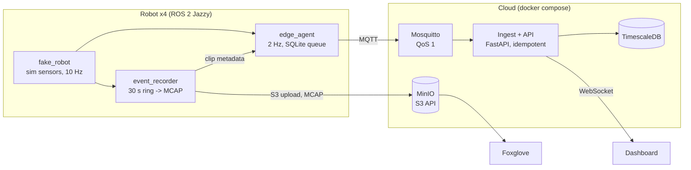

# Design: ROS 2 cloud fleet telemetry

## Goal

Simulated ROS 2 robots stream telemetry to a cloud backend, faults upload short MCAP clips,
and a dashboard shows the fleet live. Cutting a robot's network for 60 seconds loses no data;
it backfills on reconnect.

## Non-goals

Gazebo or Nav2 simulation, auth and multi-tenancy, Kubernetes, alerting, a C++ recorder.

## Data flow

Telemetry and events reach the cloud through one path: the edge agent over MQTT.
Clips skip the broker and upload straight to object storage. The recorder hands each
clip's metadata to the edge agent, so incident records survive outages the same way
telemetry does. Large files never travel over MQTT. Each clip is stored in the `incidents` bucket under the key
`{robot_id}/{event_ts}.mcap` (event_ts in UTC ms); the bucket name isn't repeated in the key.

## MQTT topics

| Topic | Payload | QoS, retained |
|---|---|---|
| `fleet/{robot_id}/telemetry` | `robot_id, boot_id, seq, ts, x, y, heading, speed, battery, mode` | 1, no |
| `fleet/{robot_id}/status` | `online`, `degraded` or `offline` (the Last Will) | 1, yes |
| `fleet/{robot_id}/events` | `robot_id, seq, ts, type, mcap_key, size_bytes` | 1, no |

## Message schema

JSON. Every message carries `robot_id`, `seq` (counts up per robot) and `ts` (UTC milliseconds).
`ts` is set when the message is created on the robot, not when it is sent, so a
redelivered or backfilled message is identical to the original.

`mcap_key` in an event is that object key, without the bucket name.

`ts` and `boot_id` are UTC ms integers. `battery` is a fraction from 0.0 to 1.0 (null if unknown). `mode` is always `driving`.

## Tables

| Table | Columns | Notes |
|---|---|---|
| `telemetry` | `robot_id, boot_id, seq, ts, x, y, heading, speed, battery, mode` | Hypertable on `ts`; unique on (`robot_id`, `seq`, `ts`) |
| `robots` | `robot_id, last_seen, status, last_state` | `last_seen`/`last_state` from telemetry, forward only (newer `ts` wins); `status` from the status topic |
| `incidents` | `id, robot_id, ts, type, mcap_key, size_bytes` | One row per clip; unique on `mcap_key` |

Inserts are idempotent (`ON CONFLICT DO NOTHING`) because QoS 1 guarantees duplicates.
TimescaleDB requires unique keys on a hypertable to include the time column, hence
`ts` in the telemetry key.
